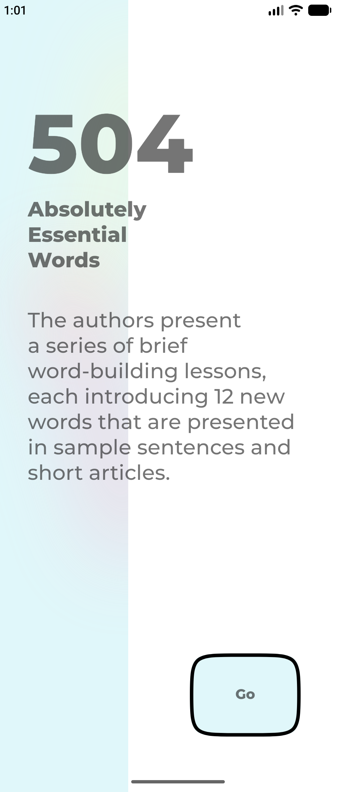
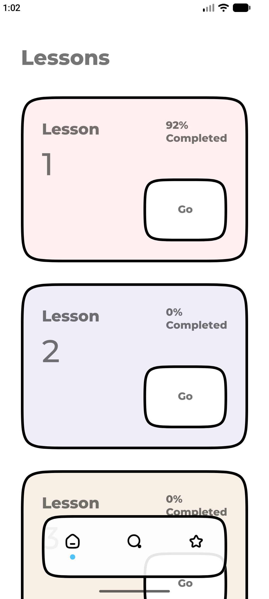
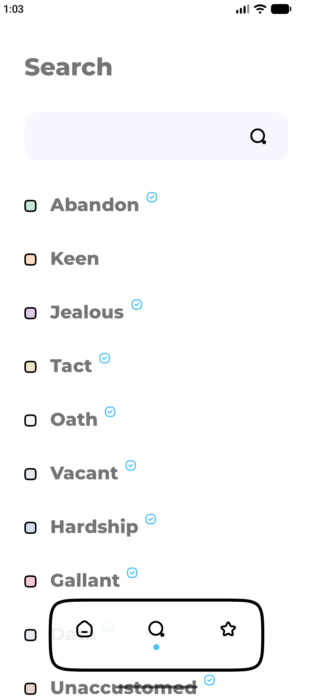
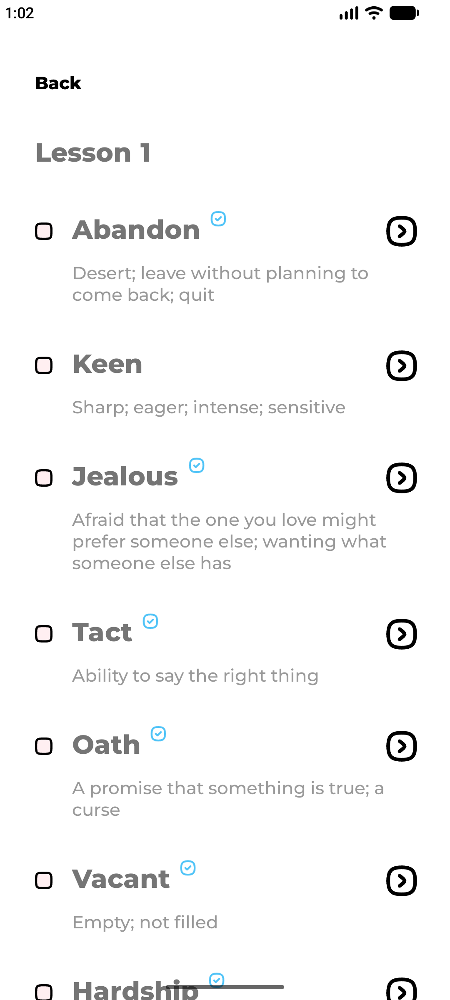
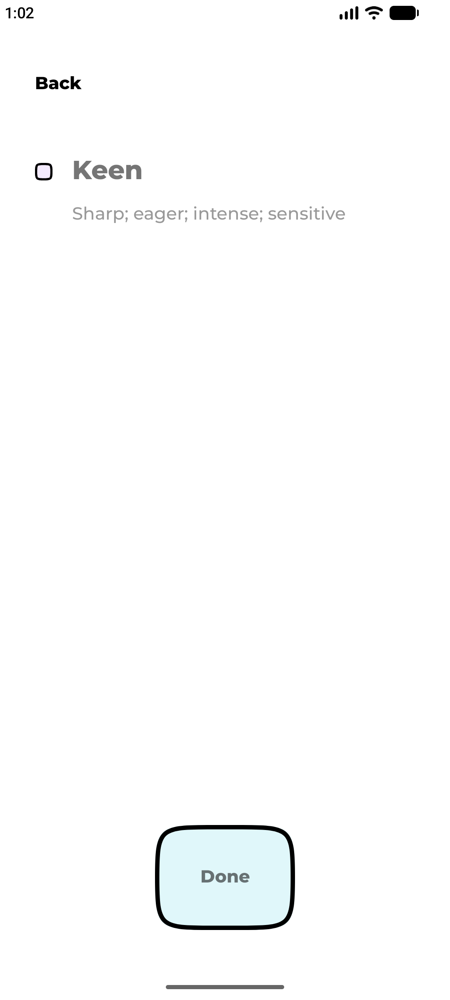

## Screenshots

  A visual tour of the Essential 504 Android application. 
  Discover lessons, search vocabulary, and explore individual words.

<table>
  <tr>
    <td align="center">
      <h3>Splash</h3>
      
    </td>
    <td align="center">
      <h3>Lessons</h3>
      
    </td>
    <td align="center">
      <h3>Search</h3>
      
    </td>
  </tr>
  <tr>
    <td align="center">
      <h3>Lesson Details</h3>
      
    </td>
    <td align="center">
      <h3>Word Details</h3>
      
    </td>
    <td></td>
  </tr>
</table>

  Built with Java · Android · ObjectBox

